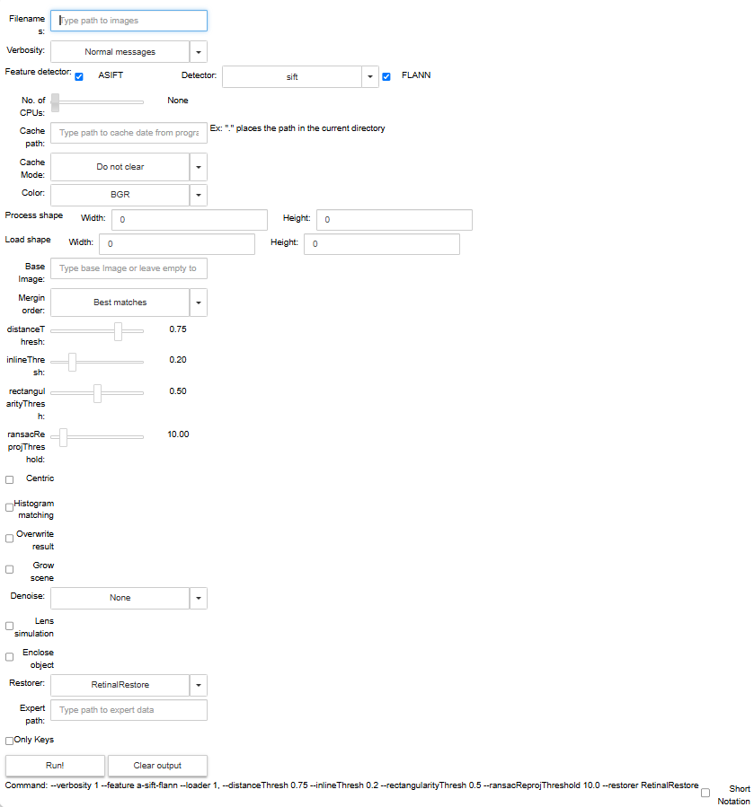
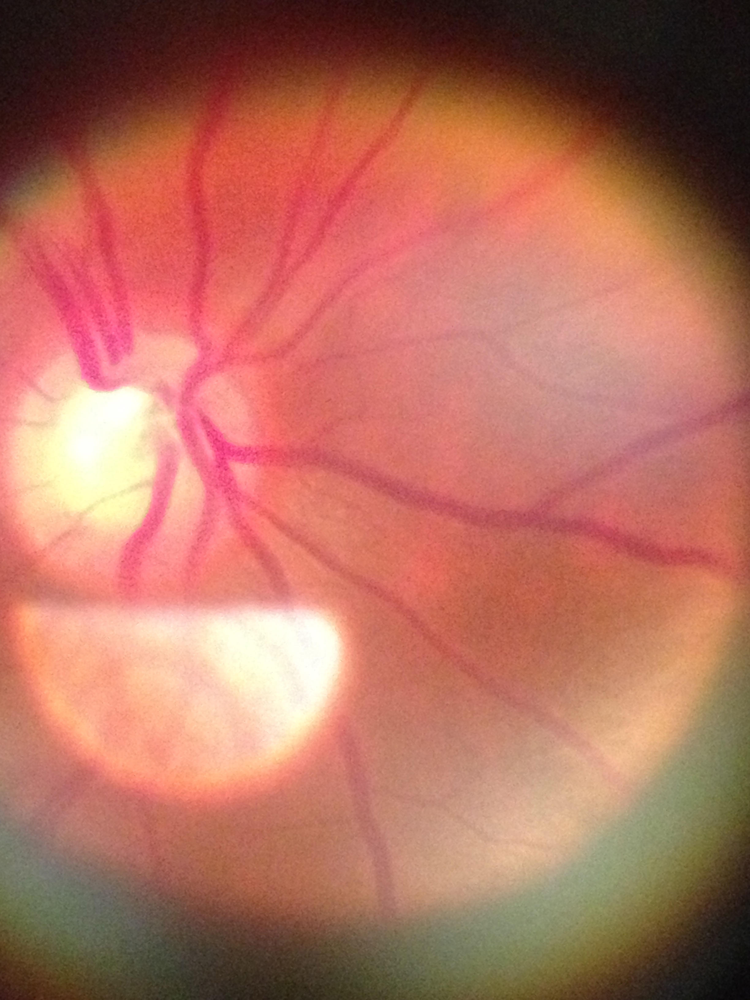
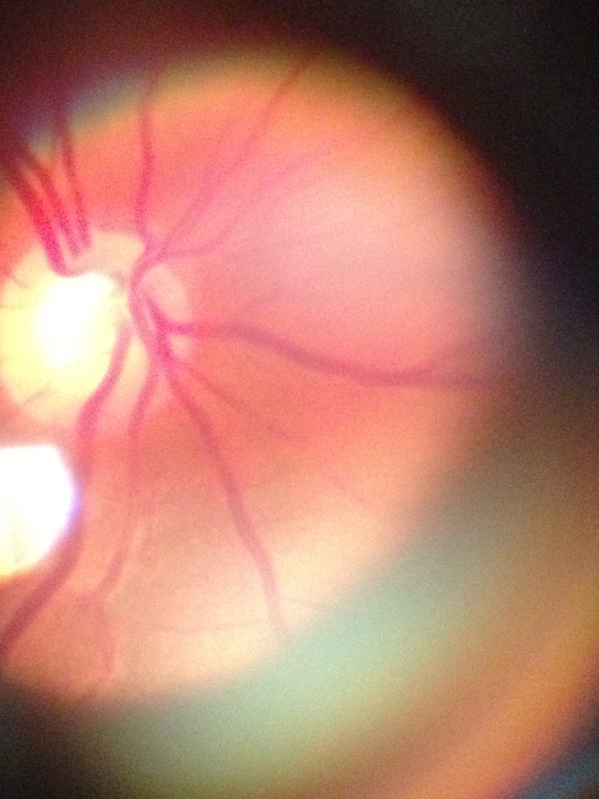
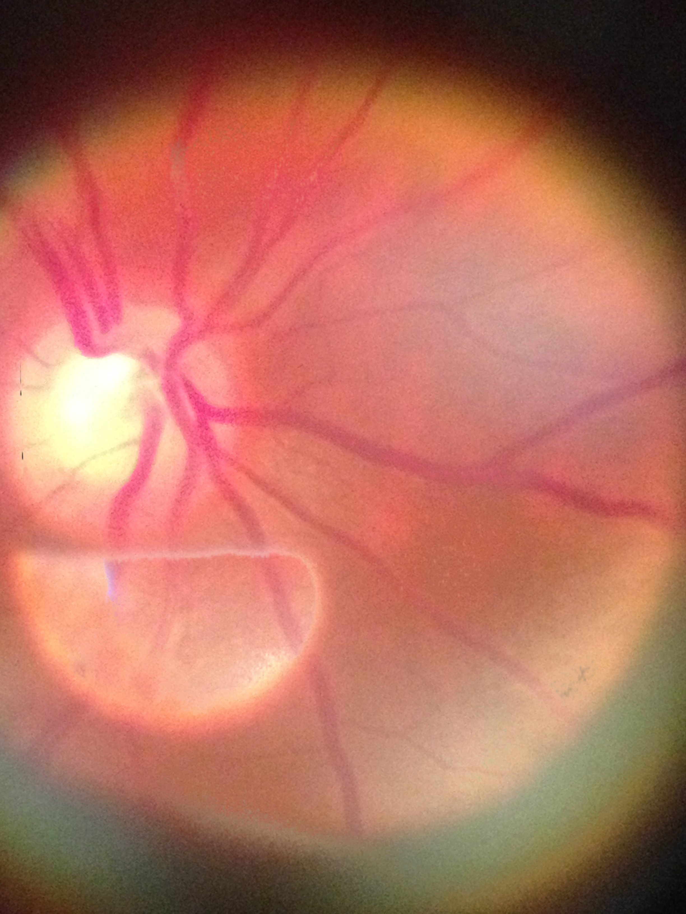
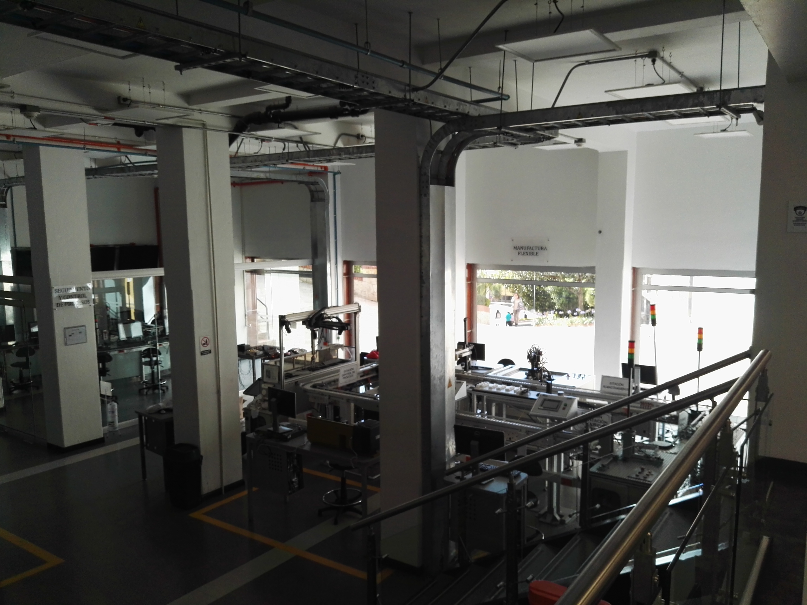
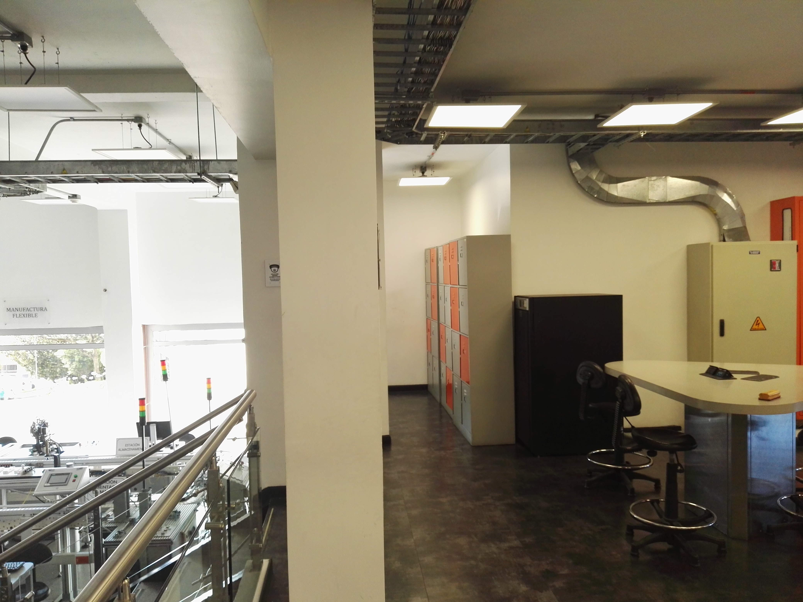
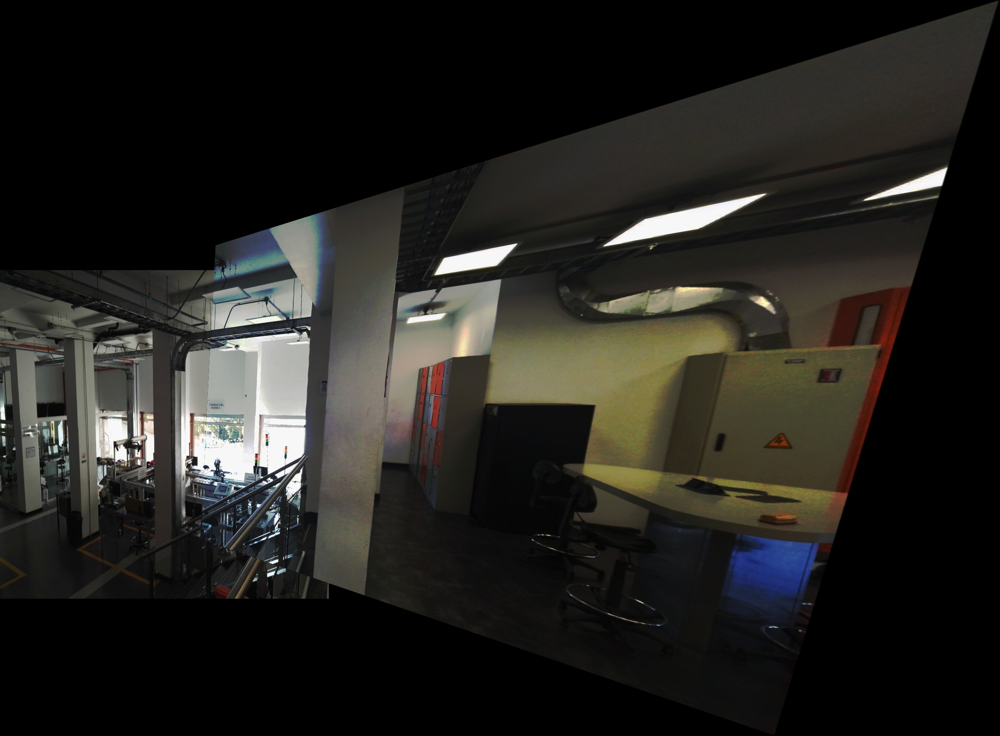
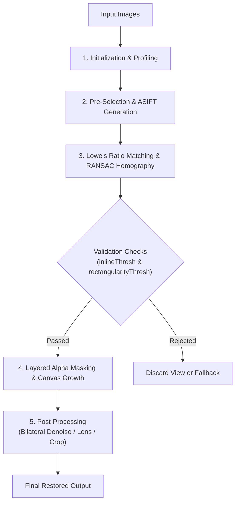

# RRtools Demo & Results Showcase

Welcome to the **RRtools Showcase and Visual Guide**! This document provides an interactive tour of the algorithms, parameter studio, step-by-step pipeline inspection, and real-world restoration results in **retinal imaging** and **wide-field perspective stitching**.

---

## Table of Contents
- [Interactive Parameter Studio (`ImRestore_demo.html` / `ImRestore_demo.ipynb`)](#interactive-parameter-studio)
  - [Overview & Workflow](#overview--workflow)
  - [Parameter Reference & Command Builder](#parameter-reference--command-builder)
- [Showcase 1: Retinal Glare Elimination & Reconstruction](#showcase-1-retinal-glare-elimination--reconstruction)
  - [Problem Statement](#retinal-problem-statement)
  - [Before & After Comparison](#retinal-comparison)
  - [How It Works](#retinal-algorithm)
  - [Reproduce with CLI](#retinal-cli)
- [Showcase 2: Wide-Field Indoor Panoramic Stitching](#showcase-2-wide-field-indoor-panoramic-stitching)
  - [Problem Statement](#panoramic-problem-statement)
  - [Input Views & Perspective Composite](#panoramic-comparison)
  - [How It Works](#panoramic-algorithm)
  - [Reproduce with CLI](#panoramic-cli)
- [System Architecture & UML Diagrams (`documentation/architecture/`)](documentation/architecture/README.md)
- [Algorithmic Walkthrough (`RRtools_steps.ipynb` & `imrestore_steps.py`)](#algorithmic-walkthrough)
  - [Phase-by-Phase Breakdown](#phase-by-phase-breakdown)
  - [Running the Interactive Steps Notebook](#running-steps-notebook)

---

<a name="interactive-parameter-studio"></a>
## Interactive Parameter Studio (`ImRestore_demo.html` / `ImRestore_demo.ipynb`)

RRtools provides an interactive visual control panel and showcase available in both a standalone zero-dependency web interface ([ImRestore_demo.html](ImRestore_demo.html)) and a Jupyter Notebook ([ImRestore_demo.ipynb](ImRestore_demo.ipynb)). It allows researchers, developers, and clinicians to interactively compare before/after restoration states, adjust computer vision parameters, and **automatically generate the exact command-line syntax** for batch execution.



### Overview & Workflow
1. **Interactive Tuning**: Adjust feature extractors, matching ratios, RANSAC thresholds, and post-processing filters via sliders and toggles.
2. **Instant CLI Command Generation**: At the bottom of the interface, the dynamic command label constructs the command string live:
   ```bash
   python imrestore.py tests/im1* --feature a-sift-flann --distanceThresh 0.75 --inlineThresh 0.2 --rectangularityThresh 0.5 --ransacReprojThreshold 10.0 --restorer RetinalRestore --lens
   ```
3. **Short Notation Toggle**: Switch between descriptive long flags (`--feature`, `--distanceThresh`) and short flags (`-f`, `-a`) for concise scripting.
4. **Direct Execution**: Click **Run!** to execute the pipeline directly in Python, stream profiler benchmarks, and display the final image in-line.

### Parameter Reference & Command Builder

| Category | Parameter | Flag | Description | Default |
| :--- | :--- | :--- | :--- | :--- |
| **Input & Verbosity** | `Filenames` | positional | Image paths or glob pattern (e.g., `tests/im1*`) | — |
| | `Verbosity` | `-v`, `--verbosity` | Output detail: `0` (Silent) to `5` (Full debug & figures) | `1` |
| **Feature Extraction** | `ASIFT` | `-f a-...` | Affine simulation for viewpoint & tilt invariance | `True` |
| | `Detector` | `-f ...-sift` | Core keypoint detector: `sift`, `surf`, `orb`, `brisk` | `sift` |
| | `FLANN` | `-f ...-flann` | Fast Library for Approximate Nearest Neighbors matcher | `True` |
| **Performance** | `No. of CPUs` | `-u`, `--pool` | Multiprocessing pool workers (`None` for sequential) | `None` |
| | `Cache path` | `-c`, `--cachePath` | Directory for memoized descriptors and keypoints | `""` |
| | `Cache Mode` | `-e`, `--clearCache` | `0` (Preserve), `1` (Integrity check), `2` (Re-compute), `3` (Purge) | `0` |
| **Filtering & Match Thresholds** | `distanceThresh` | `--distanceThresh` | Lowe's ratio test threshold for rejecting ambiguous matches | `0.75` |
| | `inlineThresh` | `--inlineThresh` | Minimum inlier match ratio to accept homography | `0.20` |
| | `rectangularityThresh` | `--rectangularityThresh` | Geometric distortion threshold for warped quadrilateral | `0.50` |
| | `ransacReprojThreshold` | `--ransacReprojThreshold` | Maximum reprojection error (pixels) for RANSAC inliers | `10.0` |
| **Restoration & Blending** | `Restorer` | `-z`, `--restorer` | Engine: `RetinalRestore` (glare inpainting) or `ImRestore` | `RetinalRestore` |
| | `Grow scene` | `--grow` | Expand canvas dimensions dynamically for wide stitching | `False` |
| | `Denoise` | `-y`, `--denoise` | Bilateral filter noise reduction: `mild`, `normal`, `heavy` | `None` |
| | `Lens simulation` | `-a`, `--lens` | Renders realistic optical lens aperture boundary | `False` |
| | `Enclose object` | `-k`, `--enclose` | Crops canvas to largest connected foreground object | `False` |

---

<a name="showcase-1-retinal-glare-elimination--reconstruction"></a>
## Showcase 1: Retinal Glare Elimination & Reconstruction

<a name="retinal-problem-statement"></a>
### Problem Statement
Handheld and clinical fundus photography often suffers from intense flash reflections (corneal glare). In severe cases, high-intensity reflection completely washes out critical anatomical structures like the optic disc and retinal vascular network.

<a name="retinal-comparison"></a>
### Before & After Comparison

| Input Photo 1 (`tests/im1_1.jpg`) | Input Photo 2 (`tests/im1_2.jpg`) | Restored Composite (`assets/demo/retina_restored.jpg`) |
| :---: | :---: | :---: |
|  |  |  |
| *Severe flash glare obscures the lower vascular network.* | *Camera angle shifted; lower vessels clear, glare moved to edge.* | **Glare seamlessly eliminated; vascular network fully restored!** |

<a name="retinal-algorithm"></a>
### How It Works
1. **Glare & Foreground Masking**: The algorithm segments the overexposed glare region using luminance thresholding and morphology (`get_bright_alpha`).
2. **Affine-Invariant Feature Matching**: ASIFT identifies matching vascular bifurcations across images regardless of camera tilt or rotation.
3. **Layered Alpha Blending**: Instead of a naive cross-fade, `RRtoolbox.tools.segmentation.get_layered_alpha` constructs an optimal replacement weight map. High-confidence vascular details from the second image replace the glare mask.
4. **Lens Simulation**: An optical aperture vignette is simulated (`simulateLens`) to produce a clean clinical fundus presentation.

<a name="retinal-cli"></a>
### Reproduce with CLI
```bash
python imrestore.py tests/im1* --lens
```
Or with explicit flags:
```bash
python imrestore.py tests/im1_1.jpg tests/im1_2.jpg -v 1 -f a-sift-flann --distanceThresh 0.75 --inlineThresh 0.2 --rectangularityThresh 0.5 --ransacReprojThreshold 10.0 -z RetinalRestore --lens
```

---

<a name="showcase-2-wide-field-indoor-panoramic-stitching"></a>
## Showcase 2: Wide-Field Indoor Panoramic Stitching

<a name="panoramic-problem-statement"></a>
### Problem Statement
When capturing wide indoor scenes with complex industrial equipment, depth variations and perspective changes easily cause misalignment, double edges, and seam artifacts when using conventional panorama stitchers.

<a name="panoramic-comparison"></a>
### Input Views & Perspective Composite

| View 1: Left Workstation (`IMG_20170206_162014.jpg`) | View 2: Right Hallway (`IMG_20170206_162020.jpg`) |
| :---: | :---: |
|  |  |
| *Lower factory floor, stairs, and control stations.* | *Panned view: lockers, air ducts, and conference table.* |

#### Unified Wide-Field Composite (`_restored_IMG_20170206_162014_1.jpg`)


*Seamless homography warping and scene accumulation (`--grow`) align the structural ceiling conduits, steel railings, and floor grid into a single wide-angle projection.*

<a name="panoramic-algorithm"></a>
### How It Works
1. **Homography Estimation**: Keypoints are matched across overlapping ceiling ducts, pillar edges, and railings.
2. **Geometric Sanity Check**: `rectangularityThresh` validates that the estimated projection matrix does not introduce excessive perspective distortion.
3. **Scene Canvas Growth (`--grow`)**: The bounding canvas dynamically expands to accommodate the warped footprint of View 2 without clipping.
4. **Gradient-Aware Fusion**: Overlapping boundaries are smoothed to eliminate visible seams under varying lighting.

<a name="panoramic-cli"></a>
### Reproduce with CLI
```bash
python imrestore.py results/test3/IMG_20170206_162014.jpg results/test3/IMG_20170206_162020.jpg --grow
```

---

<a name="algorithmic-walkthrough"></a>
## Algorithmic Walkthrough (`RRtools_steps.ipynb` & `imrestore_steps.py`)

For developers and contributors wanting to explore or customize the internal pipeline, RRtools includes a dedicated step-by-step diagnostic framework.

<a name="phase-by-phase-breakdown"></a>
### Phase-by-Phase Breakdown



1. **Initialization (`__init__`)**:
   - Spawns the execution profiler (`Profiler`).
   - Initializes multiprocessing worker pool (if requested).
   - Instantiates feature extractor configuration (`Feature`) and sets Lowe's ratio distance threshold ($d \le 0.75$).
2. **Pre-Selection (`pre_selection`)**:
   - Computes keypoints and descriptors for all images.
   - Evaluates Affine-SIFT transformations across simulated camera tilts $t = 2^{0.5 \cdot n}$ ($n \in [1, 6]$) and rotations $\phi \in [0^\circ, 180^\circ]$.
   - Caches computed keypoints to disk to accelerate repeat runs.
   - Selects optimal anchor image as base reference $I_r$.
3. **Matching & Homography (`matching`)**:
   - Performs bilateral nearest-neighbor matching with Lowe's ratio test.
   - Computes homography matrix $H$ using RANSAC reprojection error threshold.
   - Evaluates transformed quadrilateral corners against `rectangularityThresh` and `inlineThresh`.
4. **Fusion & Overlay (`overlay`)**:
   - Calculates layered alpha transparency map using `get_layered_alpha(back, fore)`.
   - Expands canvas if `GROW_SCENE` is active.
   - Blends images: $I_r = \text{fore} \cdot \alpha + \text{back} \cdot (1 - \alpha)$.
   - Re-projects remaining keypoints into the updated frame of $I_r$.
5. **Post-Processing (`post_process_restoration`)**:
   - Edge-preserving denoising via bilateral filtering (`getBilateralParameters`).
   - Lens simulation overlay (`simulateLens`).
   - Foreground bounding box enclosure (`foreground` & `thresh_biggestCnt`).

<a name="running-steps-notebook"></a>
### Running the Interactive Steps Notebook
To step through the pipeline interactively with rich visual diagrams:
```bash
jupyter notebook RRtools_steps.ipynb
```
Or open [ImRestore_demo.html](ImRestore_demo.html) directly in any web browser to view the exported interactive environment!
