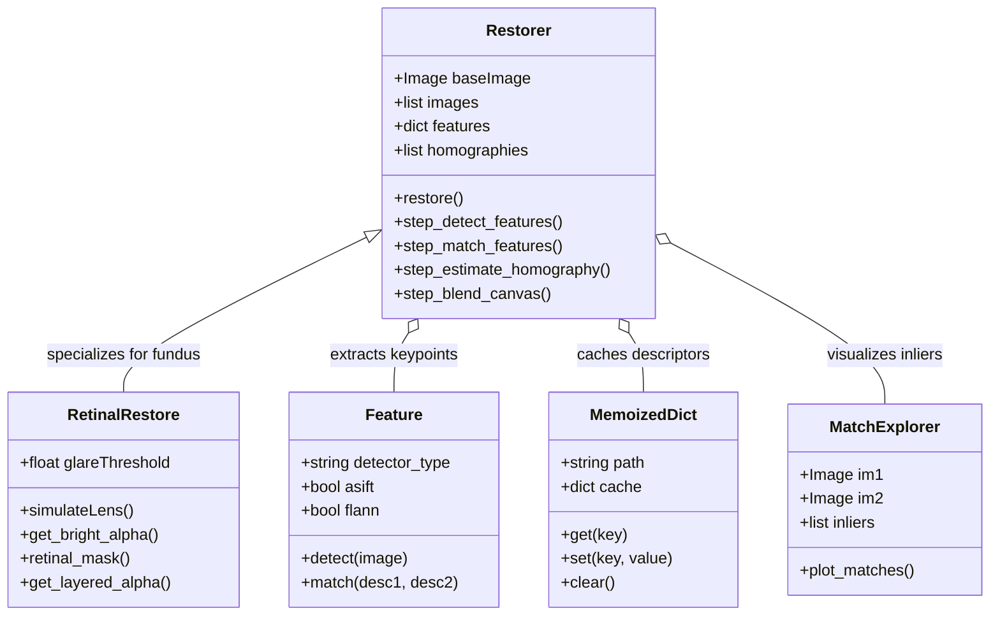
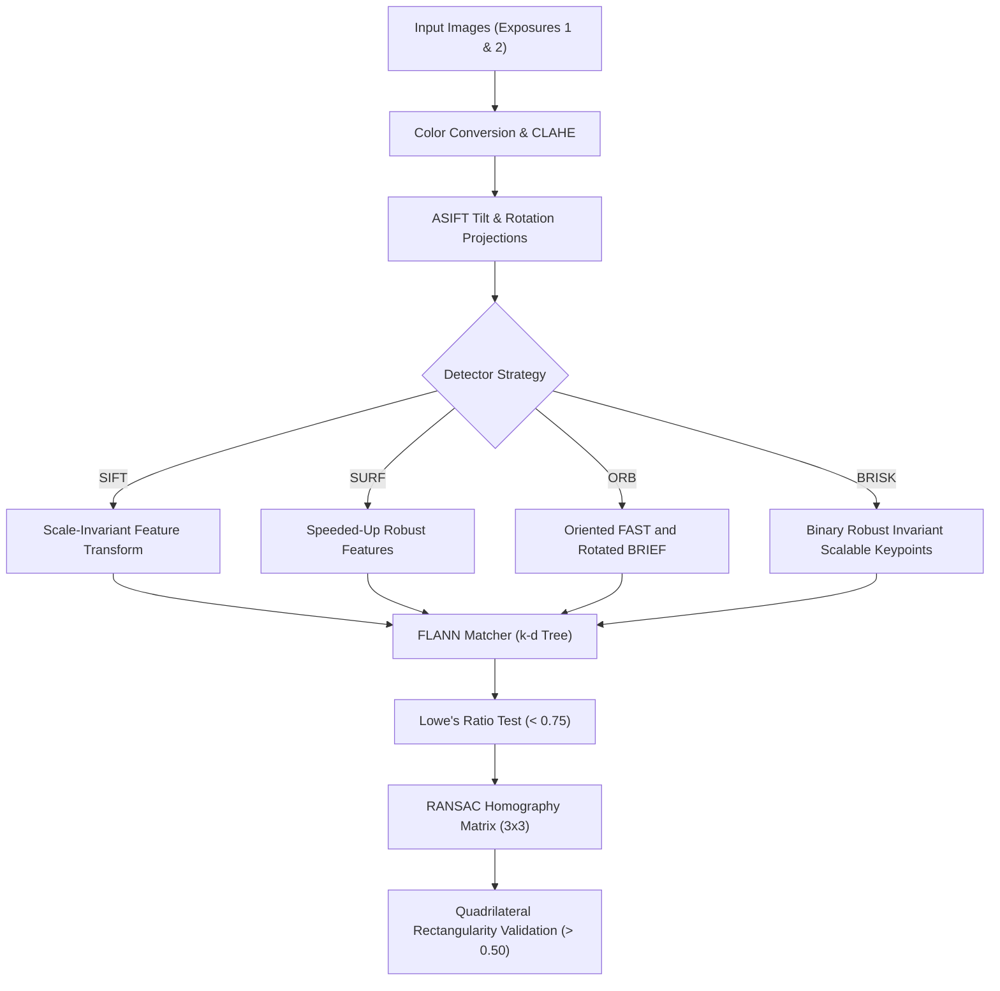
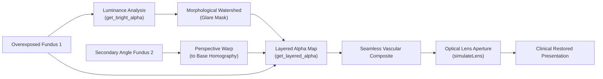
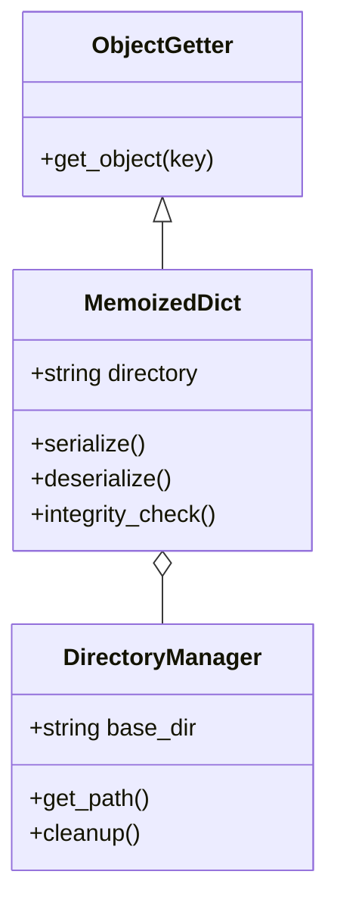

# RRtoolbox Architecture & UML Diagrams

This directory contains the system architecture specifications, modern text-as-code class diagrams (Mermaid.js), and legacy diagram exports for **RRtools**.

---

## 1. High-Level System Architecture

The core pipeline in RRtools orchestrates feature detection, geometric matching, homography estimation, luminance segmentation, and layered alpha blending:



---

## 2. Feature Detection & Affine Simulation Subsystem

RRtools provides robust invariant matching across varying tilts and angles using ASIFT (Affine SIFT) combined with the FLANN k-d tree search:



---

## 3. Retinal Glare Elimination & Layered Fusion

In clinical fundus photography, flash glare washes out critical diagnostic structures. The `RetinalRestore` engine dynamically isolates the reflection and substitutes valid anatomical structures from secondary perspectives:



---

## 4. Caching & Memory Management Subsystem

To optimize heavy computer vision routines and avoid redundant descriptor calculations:



---

## 5. Legacy Diagrams Reference

This directory also retains the historical reference diagram files:

* [RRtoolbox.svg](file:///c:/dev/projects/products/rrtools/documentation/architecture/RRtoolbox.svg): Monolithic 25,871 × 6,974 px diagram generated via PyCharm's yFiles (ySVG) export engine.
* [RRtoolbox.uml](file:///c:/dev/projects/products/rrtools/documentation/architecture/RRtoolbox.uml): PyCharm's XML UML diagram file.
* [legacy_staruml_html/](file:///c:/dev/projects/products/rrtools/documentation/architecture/legacy_staruml_html): Historical StarUML HTML documentation export for the "Object counter" and "MOSSE" milestones.

### How to Regenerate Class Diagrams with `pyreverse`
Instead of manually drawing diagrams, generate fresh, code-synchronized UML using `pyreverse` (included with `pylint`):

```bash
# Generate PlantUML format
pyreverse -o puml -p RRtoolbox RRtoolbox/

# Generate Mermaid format
pyreverse -o mmd -p RRtoolbox RRtoolbox/
```
