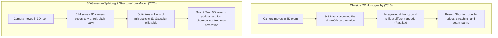
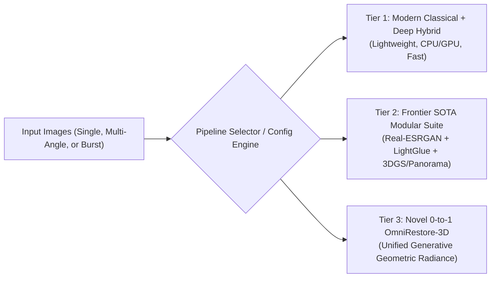
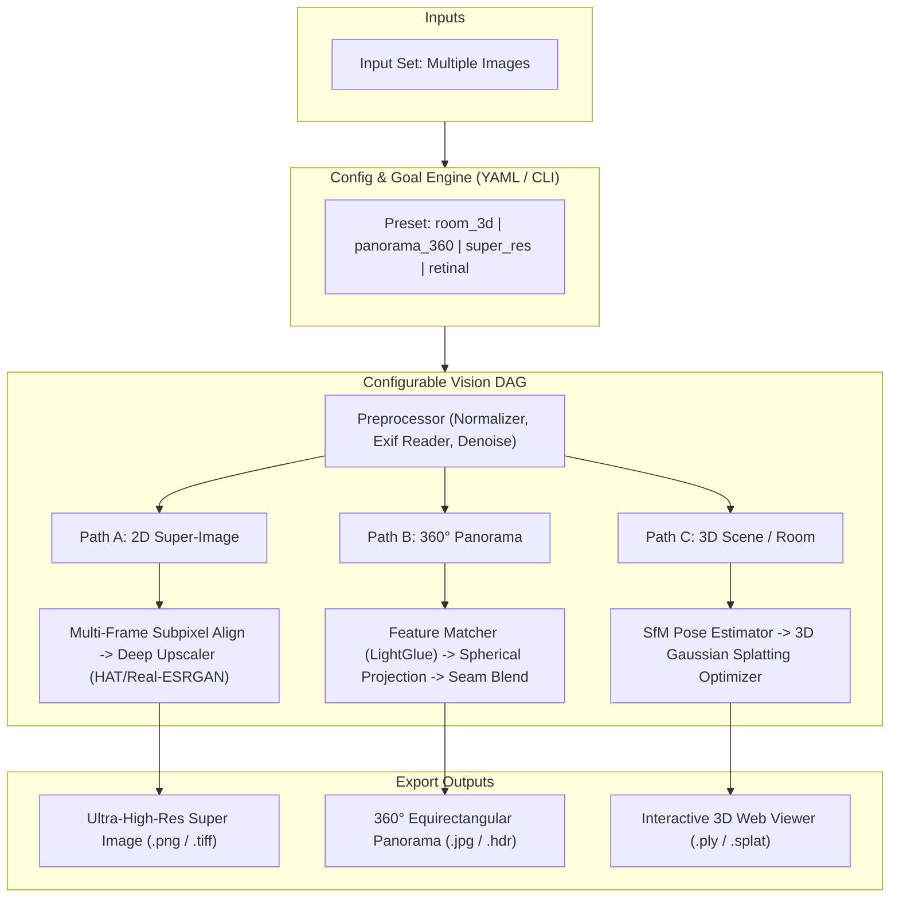

# Frontier Vision Modernization Roadmap: Evolving RRtools into an Advanced Multi-Modal Scene & Image Restoration Platform

## Executive Summary & Historical Context

**RRtools** (built circa 2015–2017) is an exceptionally well-engineered classical computer vision codebase. It encapsulated the pinnacle of that era's toolchain: **ASIFT** (Affine SIFT) keypoint extraction, **FLANN** KD-tree nearest-neighbor matching, **RANSAC** 3x3 projective homography estimation, luminance segmentation, and layered alpha-mask blending.

However, in the decade since its inception, computer vision underwent two generational paradigm shifts:
1. **The Deep Learning Revolution (2016–2022)**: Moving from handcrafted heuristic descriptors (SIFT, SURF, ORB) to learned, transformer-based correspondence engines (SuperPoint, LightGlue, LoFTR) and neural restoration (Restormer, Real-ESRGAN, HAT).
2. **The 3D Radiance & Splatting Revolution (2022–2026)**: Moving from 2D planar homography stitching to true volumetric 3D scene representations (**NeRF** and **3D Gaussian Splatting / 3DGS**), enabling true 6-DoF novel view synthesis, 360° spherical unrolling, and parallax-free multi-view reconstruction.

This architectural blueprint outlines how to transform RRtools from a specialized 2D retinal stitcher into a **general-purpose, highly configurable multi-modal restoration engine**.

---

## 1. Demystifying the 10-Year Technical Leap

To understand why modern techniques produce radically superior results for general scenes (rooms, objects, high-resolution landscapes), we must analyze why classical methods struggle outside of controlled retinal photography:

### The Planar Homography Bottleneck vs. 3D Parallax

* **Analogy**: Classical homography is like taking photos of a room, cutting out paper prints, and trying to paste them flat on a table—they only line up if the room is completely flat or the camera never moved its position. Modern 3D reconstruction builds a real miniature clay sculpture of the room and projects the colors onto it.

### Feature Matching: SIFT vs. Transformers
* **Classical (SIFT/ASIFT)**: Looks for small local gradient patches. Fails miserably on blank white walls, wooden floors with repeating grain, reflective mirrors, or changes in room lighting.
* **Modern (SuperPoint + LightGlue / LoFTR)**: Neural networks with attention mechanisms that look at the entire context of the image. They can match a doorknob, corner, or shadow even if the lighting changes completely or the camera perspective shifts by 80°.

### Restoration: Alpha Blending vs. Multi-Frame Super-Resolution
* **Classical (Layered Alpha Masking)**: Good for replacing a bright glare patch with an alternative photo, but cannot synthesize missing details or increase resolution.
* **Modern (Multi-Frame Super-Resolution & Diffusion Priors)**: Utilizes the sub-pixel jitter between multiple handheld shots to recover authentic optical frequency information that was not captured by any single frame, producing crisp, high-fidelity "super-images".

---

## 2. The 3-Tier SOTA Architecture Proposals

We formulate three distinct evolution paths based on hardware targets, complexity, and product ambition:

### Tier 1: Pragmatic Modernization (Deep-Enhanced 2D/360 Hybrid)
* **What it is**: Preserves RRtools' Python CLI/GUI structure and caching philosophy, but swaps obsolete components for modern drop-in replacements.
* **Key Components**:
  * **Feature Engine**: Upgrade OpenCV 4.10+ with optional **LightGlue** / **DISK** neural matching.
  * **Stitching**: Spherical and cylindrical warping engines for 360° panoramas with seam cutting via graph-cuts.
  * **Super-Resolution**: Single-image upscaling via ONNX-optimized **Real-ESRGAN** / **SwinIR** (runs fast on both CPU and standard consumer GPUs).
  * **Modularity**: A YAML-driven config system allowing presets (`retinal`, `room_panorama`, `document_scan`, `super_resolution`).
* **Pros**: Low technical debt; runs anywhere without heavy CUDA dependencies; backward compatible with existing RRtools workflows.
* **Cons**: Still fundamentally 2D/cylindrical; cannot synthesize true 3D room geometry or walkthroughs.

---

### Tier 2: Frontier SOTA Modular Vision Suite (Recommended)
* **What it is**: A multi-modal pipeline architecture that categorizes tasks into three distinct configurable pipelines:
  1. **Single/Burst Enhancement**: Multi-Frame Super-Resolution (MFSR) + Generative Inpainting for glare, shadows, and reflections.
  2. **Wide-Field & 360°**: Equirectangular projection builder with multi-band spherical blending.
  3. **Multi-View 3D Reconstruction**: Automated Structure-from-Motion (COLMAP / GLOMAP) feeding real-time **3D Gaussian Splatting** (`gsplat`).
* **Key Components**:
  * **Registration Engine**: SuperPoint + LightGlue for ultra-robust keypoints across wild angles.
  * **3D Scene Engine**: 3D Gaussian Splatting exporting interactive `.ply` files viewable at 60+ FPS in any web browser (WebGL/WebGPU).
  * **Super-Resolution Engine**: Multi-frame burst super-resolution utilizing sub-pixel alignment + HAT (Hybrid Attention Transformer).
  * **Config Engine**: Directed Acyclic Graph (DAG) pipeline orchestrator (`task_graph.py`) where inputs and processors chain declaratively.
* **Pros**: State-of-the-art visual quality across both 2D and 3D; produces interactive 3D rooms or super-images automatically based on input configuration.
* **Cons**: Requires PyTorch with CUDA for fast 3DGS training (though pre-trained 2D upscalers can run on CPU).

---

### Tier 3: Novel 0-to-1 Paradigm ("OmniRestore-3D": Continuous Generative Radiance Engine)
* **What it is**: An AI-native paradigm where 2D images are not merely stitched or upscaled, but mapped into a continuous **Neural Radiance and Diffusion Prior Field**.
* **Key Components**:
  * **Zero-Shot Pose Estimation**: Using foundation vision models (e.g., DUSt3R / MASt3R) to infer 3D camera poses and dense geometry in a single forward pass without classical bundle adjustment.
  * **Generative Geometric Outpainting**: Where photos have blind spots in a room, diffusion models fill in unseen angles while respecting physical 3D geometry.
  * **Continuous Super-Resolution**: Coordinate-based neural representation (Implicit Neural Representation / NeRF-style MLP) that can render the scene at any arbitrary zoom level without pixelation.
  * **Self-Hosting Web3D Canvas**: Direct export to a zero-install interactive WebGPU 360/3D canvas with dynamic relighting and measurement tools.
* **Pros**: Breakthrough capability; can construct 3D rooms from only 3–5 sparse photos; eliminates conventional calibration failures.
* **Cons**: Highest computational requirements; requires cutting-edge research weights (DUSt3R/MASt3R).

---

## 3. Comparative Matrix

| Feature Dimension | Current RRtools (2015) | Tier 1: Modern Hybrid | Tier 2: Frontier SOTA (Recommended) | Tier 3: Novel 0-to-1 |
| :--- | :--- | :--- | :--- | :--- |
| **Feature Extraction** | SIFT, SURF, ASIFT (OpenCV) | OpenCV 4.x + LightGlue | SuperPoint + LightGlue + LoFTR | DUSt3R / MASt3R (Pose-free) |
| **Geometry Model** | 2D Projective Homography ($3\times3$) | Cylindrical / Spherical Stitching | COLMAP SfM + 3D Gaussian Splatting | Dense 3D Pointmaps & Splats |
| **3D Room Synthesis** | ❌ None | ❌ Flat / Cylindrical only | ✅ Real 3D Gaussian Splat (`.ply`) | ✅ Complete 3D Hallucinated Mesh |
| **360° Panorama** | Naive Canvas Growth (`--grow`) | Equirectangular Spherical Projection | Multi-band 360° Spherical Fusion | 360° Generative Inpainted Dome |
| **Super-Resolution** | Bilateral Filter & Resizing | Real-ESRGAN / SwinIR (4x SISR) | Multi-Frame Burst SR + HAT | Continuous Implicit Neural Scaling |
| **Domain Agility** | Tuned for Retina | Configurable (Retina, Scenery) | Fully Configurable Vision Graph | Autonomous Scene Reasoner |
| **Compute Req.** | CPU Multiprocessing | CPU or Budget GPU | NVIDIA GPU (CUDA 6GB+ recommended) | High-end GPU (CUDA 12GB+) |

---

## 4. Proposed Modular Task-Graph Architecture

To make RRtools configurable for any scenario (retinal, multi-angle room, single super-image, 360 panorama), we decouple the monolithic `imrestore.py` into a composable **Task Graph**:

---

## 5. Implementation Roadmap (Phased Execution)

### Phase 1: Foundation & Modular Pipeline Core
1. **Pipeline Graph Engine**: Create `RRtoolbox/pipeline/` with declarative stage execution (`Stage`, `Pipeline`, `Recipe`).
2. **Modern Feature Engine**: Integrate **LightGlue** (with fallback to modern OpenCV SIFT/ORB) for robust multi-angle correspondence.
3. **Preset System**: Allow running via CLI:
   * `python -m rrtools --recipe super-res images/*`
   * `python -m rrtools --recipe panorama-360 images/*`
   * `python -m rrtools --recipe room-3d images/*`

### Phase 2: Super-Resolution & 360° Panorama Engines
1. **Multi-Frame & Single-Image SR**: Integrate ONNX Runtime / PyTorch loader for Real-ESRGAN / HAT for crisp upscaling.
2. **Equirectangular 360° Stitcher**: Spherical warping engine to merge indoor photos into immersive panoramas.

### Phase 3: 3D Gaussian Splatting Integration
1. **Pose Engine**: Integrate lightweight COLMAP wrapper or zero-shot pose matcher.
2. **Splat Optimization**: Connect to `gsplat` to generate photorealistic 3D point clouds and Gaussian splats.
3. **Web Viewer**: Bundle an embedded, zero-install WebGL viewer (`imrestore_view3d.html`) so users can pan and fly through the restored 3D room directly in their browser.

---

## 6. SRA (Single Riskiest Assumption) & SPIKE Protocol

Before writing large-scale scaffolding, we isolate the core technical uncertainty:

> **Single Riskiest Assumption**: Can modern deep feature matchers (LightGlue) and lightweight subpixel registration run smoothly in the existing environment and achieve seamless multi-angle alignment where classical OpenCV ASIFT fails?

We can execute an isolated SPIKE script in `scratch/spike_modern_matcher.py` on real multi-angle indoor samples to benchmark match count, inlier ratio, and execution time before finalizing the architecture.
